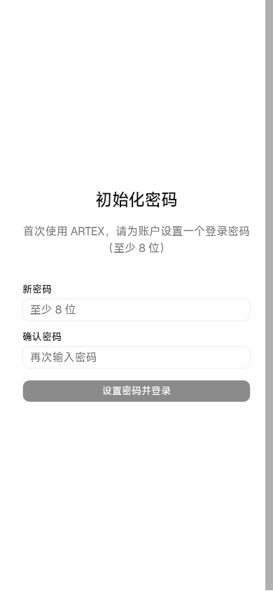

# ARTEX Magisk 模块 · Android 上的 AI 渗透测试平台

> 把 [ARTEX](https://github.com/Autumn-27/ARTEX)（AI 自主渗透测试系统，Go + Next.js）打包成
> **一个可刷入的 Magisk 模块**：设备里跑起一个 Debian 12 容器，容器内自带 PostgreSQL 15，
> 开机自启，浏览器打开 `http://手机IP:8787` 随时使用。
>
> **本项目是第三方打包，与 ARTEX 上游项目无隶属关系。** 上游是 Web 应用，本项目只负责
> 「在 Android 上把它装起来、跑起来、开机就在、数据不丢」。


```
Android 14 (实测) · arm64 · Magisk / KernelSU / APatch · Debian 12 + PostgreSQL 15 · 单二进制内嵌前端
```



---

## 目录

- [它解决了什么问题](#它解决了什么问题)
- [功能](#功能)
- [系统要求](#系统要求)
- [安装](#安装)
- [使用](#使用)
- [装更多工具（Python / Node / apt）](#装更多工具python--node--apt)
- [架构](#架构)
- [为什么需要一个 SysV 共享内存垫片](#为什么需要一个-sysv-共享内存垫片)
- [数据、升级与卸载](#数据升级与卸载)
- [常见问题](#常见问题)
- [安全提示](#安全提示)
- [从源码构建](#从源码构建)
- [致谢与许可](#致谢与许可)

---

## 它解决了什么问题

ARTEX 上游给的部署方式是 Docker 或「本地编译 + 自备 PostgreSQL」，
在 Android 上两条路都走不通：

| 障碍 | 本项目怎么绕过去的 |
| :--- | :--- |
| Android 不能跑 glibc 动态程序（官方 Go/Node 的 ELF 直接被 bionic 拒绝执行） | 全部塞进一个 **Debian 12 arm64 rootfs**，用 `chroot` 提供 glibc 运行环境 |
| ARTEX 强依赖 PostgreSQL，而 Android 上没有可用的 PG | rootfs 内装 **PostgreSQL 15**，只监听 `/run/postgresql` 的 unix socket，不对外暴露 |
| Android GKI 内核普遍关闭 `CONFIG_SYSVIPC`，`shmget` 直接 ENOSYS，PG 连 initdb 都过不去 | 自带 30 行 `libsysv-shim.so`（mmap 顶替 SysV 段）+ `shared_memory_type = mmap` |
| 重启后没人拉起服务 | Magisk `service.sh`（late_start）+ 30 秒间隔的守护循环 |
| 升级一次模块就把装的工具冲掉 | 持久化工具层：容器内 `/usr/local`、`/opt/tools` 绑定到 `/data/artex/app/persist` |

## 功能

- **一键刷入**：模块 zip 自包含（rootfs + 二进制 + 前端），离线可装，刷完重启即用。
- **开机自启 + 崩溃自愈**：`service.sh` 拉起 PostgreSQL 与 ARTEX，守护循环探活重启。
- **单端口访问**：`http://<手机IP>:8787`，HTTP API 与前端同源，前端资源已编译进二进制（`-tags embedui`）。
- **数据全持久化**：数据库、任务、jwt.key、skills 都在 `/data/artex`，模块升级不动。
- **预装工具链**：Python 3.11 + pip + venv、Node 24 + npm、git、curl、wget、jq、dig、nc、ripgrep、sqlite3、nmap、vim-tiny…
- **统一的工具安装入口** `tools.sh`：apt / pip / npm 三类安装方式，各自落到正确的持久化位置。
- **端口可改**：`/data/adb/artex/ports.conf`，改完重启生效。
- **模块动作按钮**：在 Magisk/KernelSU 模块卡片里点「运行」= 停止/启动切换 + 状态摘要。

## 系统要求

| 项目 | 要求 |
| :--- | :--- |
| 架构 | **arm64 (aarch64)**，x86_64 / armv7 不支持 |
| Android | 实测 Android 14（SDK 34）；理论 Android 10+ |
| 内核 | 需支持 `chroot`、`mount -t proc/tmpfs`、`mount --bind`；GKI 5.4 实测 |
| Root | Magisk（实测 alpha 30100）/ KernelSU / APatch |
| 存储 | 安装需 ~1.5 GB 空闲；`pgdata` 会随任务数据增长 |
| 内存 | 建议 ≥ 3 GB；PG 默认 128 MB shared_buffers + ARTEX 常驻约 150–250 MB |
| 端口 | 默认占用 8787（网页）、8788（流量录制代理，仅本机） |

## 安装

### 方式一：Magisk 应用（推荐）

1. 到 [Releases](../../releases/latest) 下载 `artex-magisk-*.zip`（约 144 MB）。
2. Magisk 应用 → **模块** → **从本地安装** → 选择 zip。
3. 重启设备。
4. 浏览器访问 `http://<手机局域网IP>:8787`，首次进入会要求**设置访问密码**。

### 方式二：命令行

```sh
su -c 'magisk --install-module /sdcard/Download/artex-magisk-v0.3.15-r3.zip'
# 命令行安装会先进 modules_update，重启后生效；也可以手动搬家后直接启动：
su -c 'cp -a /data/adb/modules_update/artex/. /data/adb/modules/artex/ && rm -rf /data/adb/modules_update/artex && sh /data/adb/modules/artex/service.sh'
```

### 首次启动耗时

首次开机要 `initdb` 并建库建表，约 **20–60 秒**；期间网页打不开是正常的，看日志：

```sh
su -c 'tail -f /data/adb/artex/service.log'
```

## 使用

### 端口与行为

编辑 `/data/adb/artex/ports.conf` 后重启（或点模块「运行」按钮重启服务）：

```ini
WEB_PORT=8787              # 网页端口，监听 0.0.0.0
PROXY_ADDR=127.0.0.1:8788  # 流量录制代理，仅本机回环，留空则关闭
KEEP_AWAKE=1               # 1=运行期间阻止休眠（保证随时可访问）
```

### 常用命令

```sh
su -c 'tail -f /data/adb/artex/service.log'        # 服务/守护日志
su -c 'tail -f /data/artex/app/logs/artex.log'     # 应用日志
su -c 'tail -f /data/artex/app/logs/postgresql.log'# 数据库日志
su -c 'chroot /data/artex/rootfs /bin/bash'        # 进容器
su -c '/data/adb/modules/artex/service.sh'         # 手动重启服务
su -c 'curl -s http://127.0.0.1:8787/api/health'   # 健康检查
```

### 目录

| 路径 | 内容 |
| :--- | :--- |
| `/data/adb/modules/artex/` | 模块本体：`module.prop`、`service.sh`、`common.sh`、`action.sh`、`tools.sh`、`uninstall.sh` |
| `/data/adb/artex/` | 配置与日志：`ports.conf`、`service.log`、`apt-packages.list` |
| `/data/artex/rootfs/` | Debian 12 rootfs（约 648 MB） |
| `/data/artex/app/` | `artex` 二进制、`config.json`、`skills/`、`jwt.key`、`data/`、`persist/` |
| `/data/artex/pgdata/` | PostgreSQL 数据目录 |

## 装更多工具（Python / Node / apt）

镜像已预装 Python、Node 和一批命令行工具。ARTEX 的 **Bash 工具**、**command 工具**、
**script(Python) 工具** 都跑在这个容器里，`PATH` 已包含
`/usr/local/venv/bin`、`/usr/local/bin`、`/opt/node/bin`。

统一入口：

```sh
T=/data/adb/modules/artex/tools.sh

sh $T list                          # 看已装了什么
sh $T pip install requests httpx    # Python 包（装进持久 venv）
sh $T npm install playwright        # Node 全局包（装进持久 /usr/local）
sh $T install masscan seclists      # apt 包（自动记录，模块升级时重装）
sh $T run "python3 -c 'import requests; print(requests.__version__)'"
sh $T shell                         # 进容器
```

### 什么会丢、什么不会丢

| 安装方式 | 落地位置 | 重刷模块 zip 后 |
| :--- | :--- | :--- |
| `tools.sh pip ...` | `/data/artex/app/persist/usr-local/venv` | ✅ 保留 |
| `tools.sh npm -g ...` | `/data/artex/app/persist/usr-local` | ✅ 保留 |
| 手工解压到 `/opt/tools` | `/data/artex/app/persist/tools` | ✅ 保留 |
| `tools.sh install <apt包>` | 容器 rootfs 内 | ⚠️ 目录会被重写，但包名记在 `/data/adb/artex/apt-packages.list`，刷入时自动重装（需要联网） |
| 数据库 / 任务数据 | `/data/artex/pgdata`、`/data/artex/app/data` | ✅ 保留 |

> Playwright 浏览器自动化：`sh $T npm install playwright && sh $T run "playwright install chromium"`
> （浏览器约 150 MB，装在容器 $HOME，按需执行）。

## 架构

```
Magisk service.sh（late_start，root）
└── chroot /data/artex/rootfs              ← Debian 12 arm64
    ├── bind: /opt/artex   ← /data/artex/app       （程序 + 数据 + 持久层）
    ├── bind: /var/lib/postgresql/data ← /data/artex/pgdata
    ├── bind: /usr/local   ← /data/artex/app/persist/usr-local   （pip / npm 持久层）
    ├── bind: /opt/tools   ← /data/artex/app/persist/tools       （自解压工具）
    ├── bind: /dev /proc /sys + tmpfs /dev/shm
    ├── PostgreSQL 15   unix socket /run/postgresql:5432（不监听 TCP）
    │     └── LD_PRELOAD=/opt/artex/libsysv-shim.so   ← 绕开缺失的 SysV IPC
    └── /opt/artex/artex --addr :8787   ← Go 单二进制，前端已内嵌
```

守护循环每 30 秒探一次 `pg_ctl status` 与 ARTEX 进程，掉了就拉起；
`action.sh` 提供停止/启动切换（停止状态跨重启保持，刷入新模块时自动清除）。

## 为什么需要一个 SysV 共享内存垫片

Android 的 GKI 内核通常 `CONFIG_SYSVIPC=n`，`shmget()` 返回 `ENOSYS`：

```
FATAL:  could not create shared memory segment: Function not implemented
DETAIL:  Failed system call was shmget(key=4452628, size=56, 03600).
```

- 主共享内存可以靠 `shared_memory_type = mmap` 绕开；
- 但 **`initdb` 的 bootstrap 阶段** 与 **`PGSharedMemoryCreate()`** 内部仍会直接调用 SysV
  `shmget`，这两处没有任何配置项能管到。

于是模块带了一个约 30 行的 `libsysv-shim.so`（源码见 `files/app/shim/shimsysv.c`），
把 `shmget / shmat / shmdt / shmctl` 映射到 `MAP_SHARED|MAP_ANONYMOUS` 匿名内存。
fork 出的后端进程共享同一块映射，语义与 SysV 段一致，只通过 `LD_PRELOAD` 注入
PostgreSQL 进程，不影响系统其他部分。

> 副作用：**手动 `pg_ctl start` 必须带 `LD_PRELOAD`**，否则 PG 起不来。
> 用 `service.sh` / `action.sh` / `tools.sh` 启动都不受影响。

## 数据、升级与卸载

- **升级**：直接再刷新的 zip。`rootfs.version` 变化会重解压容器（apt 包按清单重装），
  `/data/artex/pgdata`、`/data/artex/app`、持久层工具都不动。
- **备份**：备份 `/data/artex/pgdata` 与 `/data/artex/app`（`app/persist` 是你装的工具）。
- **卸载**：模块管理器里卸载即可；想保留数据重装继续用：
  ```sh
  su -c 'mkdir -p /data/adb/artex && touch /data/adb/artex/.keep_on_uninstall'
  ```

> 安全设计：`customize.sh` 与 `uninstall.sh` 在删除 rootfs 前会扫描 `/proc/mounts`
> 卸载容器内的全部 bind 挂载，**只要还有一个挂载残留就 abort**，绝不在挂载存活时递归删除
> （否则会顺着挂载点删到宿主 `/dev`、`/proc`）。

## 常见问题

**Q：能不能用 KernelSU / APatch？**
脚本不依赖 `magisk` 命令，模块目录与 `service.sh` 约定三者通用。但 KernelSU 下 `/data` 可能
只读、且 `su` 的 SELinux 上下文不同，必要时手动 `mount -o remount,rw /data` 并调整
`/data/artex` 的文件上下文。

**Q：网页能打开但扫描目标解析不到域名？**
容器内 `/etc/resolv.conf` 默认写死 `223.5.5.5 / 119.29.29.29`（ARTEX 的 Go 解析器在
chroot 里读它，**不走 VPN 和系统 DNS**）。改成你自己的 DNS 后重启服务：

```sh
su -c 'printf "nameserver 192.168.1.1\n" > /data/artex/rootfs/etc/resolv.conf'
```

**Q：低内存设备会不会被系统杀掉？**
会。守护进程 30 秒内会重新拉起，但内存持续紧张时会反复重启。可以调小 PG 的
`shared_buffers`（`/data/artex/pgdata/postgresql.conf`）或关掉 `KEEP_AWAKE` 降低存在感。

**Q：厂商 ROM（HyperOS / EMUI / ColorOS）后台被杀？**
`KEEP_AWAKE=1` 只能阻止系统休眠，挡不住厂商的进程冻结/清理，需要在电池设置里放行。

**Q：升级了模块，之前 `apt install` 的包没了？**
apt 包在 rootfs 里，会被重写；包名记录在 `/data/adb/artex/apt-packages.list`，刷入时联网自动
重装。离线刷入则需要之后手动 `sh tools.sh install <包名>`。

**Q：换 python 版本后 pip 装的包全没了？**
持久 venv 绑定 python 3.11。镜像若升级到 3.12，需要
`su -c 'rm -rf /data/artex/app/persist/usr-local/venv'` 后重启，让它重建。

**Q：ARTEX 页面里「一键更新」安全吗？**
它会替换 `/opt/artex/artex` 并以退出码 75 退出，由守护循环重新拉起。启不来时会反复重启，
重刷本模块 zip 即可回滚。

**Q：能刷到 x86 模拟器 / 32 位设备吗？**
不能，rootfs 与二进制都是 arm64。

## 安全提示

- 服务监听 **0.0.0.0:8787**，保护只有「首次设置的管理员密码 + JWT」。同一 Wi-Fi 下任何人都
  能打开登录页，**不要直接把端口暴露到公网**（需要远程访问请套 VPN 或反代加鉴权）。
- 容器内是 root，ARTEX 的 Bash 工具可执行任意命令——这是它的功能（自主渗透测试），
  也意味着它能扫描/触碰你所在的内网，请只在授权范围内使用。
- PostgreSQL 只监听 unix socket，不对外暴露 TCP，这是刻意的。

## 从源码构建

构建过程中的难点是「Android 上跑不了 glibc 程序」，所以编译全部在 Debian 容器里做。

```sh
# 0) 准备：Debian 12 arm64 rootfs（见 scripts/build-rootfs.sh）+ 官方 Go / Node arm64 tarball
# 1) 前端静态导出（在容器里跑，Next 需要的 SWC 只有 linux/arm64 版本）
cd web && npm ci && NEXT_EXPORT=1 npx next build && cd ..
rm -rf server/webui/dist && cp -a web/out/. server/webui/dist/

# 2) 后端单二进制（前端内嵌）
CGO_ENABLED=0 GOOS=linux GOARCH=arm64 go build -tags embedui -trimpath \
  -ldflags "-s -w -buildid= -X main.version=v0.3.15" -o out/artex ./cmd/artex

# 3) 组装模块 zip
./scripts/package.sh    # 把 rootfs.tar.xz + app/ + 脚本打进 artex-magisk-*.zip
```

模块源码结构：

```
module/
├── module.prop                  # 模块元信息
├── customize.sh                 # 安装：解压 rootfs、铺程序、重装用户 apt 包（带挂载安全校验）
├── common.sh                    # 公共函数：挂载、进程探测、PG/ARTEX 启停、守护、venv
├── service.sh                   # 开机入口
├── action.sh                    # 模块「运行」按钮：停止/启动切换
├── tools.sh                     # 容器工具安装入口（apt/pip/npm/run/shell）
├── uninstall.sh                 # 卸载（带挂载安全校验）
├── files/
│   ├── rootfs.tar.xz            # Debian 12 + PostgreSQL 15（刷入时解压）
│   ├── rootfs.version           # 容器版本标记，变了才重解压
│   └── app/
│       ├── artex                # 静态单二进制（内嵌前端）
│       ├── config.json          # 运行配置（skill 目录）
│       ├── libsysv-shim.so      # SysV 共享内存垫片
│       ├── shim/shimsysv.c      # 垫片源码
│       └── skills/              # ARTEX skill 集合
└── META-INF/                    # Magisk 安装器入口
```

## 版本历史

| 版本 | 说明 |
| :--- | :--- |
| v0.3.15-r3 | 预装 Python 3.11 + Node 24 + 常用 CLI；引入持久化工具层与 `tools.sh`；文档补全 |
| v0.3.15-r2 | rootfs 重做（裁剪 + PG15 调优），数据目录与 rootfs 解耦 |
| v0.3.15-r1 | 首个可用版本：Debian 12 容器 + PG15 + ARTEX 单二进制，开机自启 |

## 致谢与许可

- 应用：[ARTEX](https://github.com/Autumn-27/ARTEX)（上游作者 Autumn-27）
- 容器基础：Debian 12 arm64（LXC 官方镜像）
- 本模块的打包脚本、rootfs 裁剪、SysV 垫片为本项目原创部分。